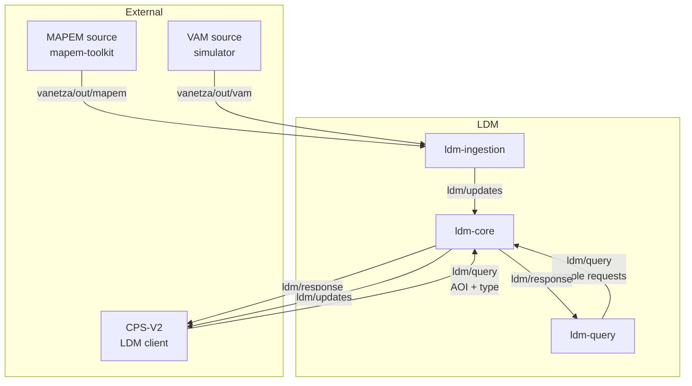
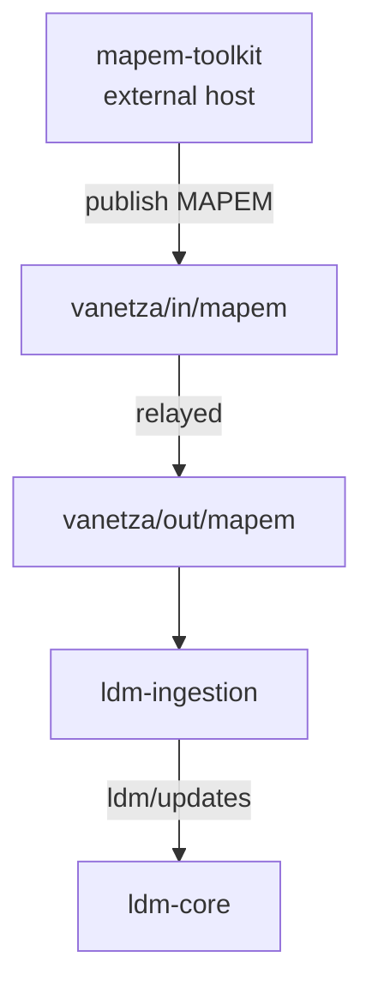

# ldm service

A Local Dynamic Map (LDM) implementation tailored for CPS V2 Clustering deployments. This service set follows ETSI EN 302 895 / TR 102 863 semantics and reuses the middleware and configuration patterns from the CPS project.

## Repository layout

- `core/` - In-memory LDM store, AoM maintenance, metrics exposer, locator, geometry, LDM model.
- `ingestion/` - MAPEM/VAM ingestion into the LDM.
- `query/` - Query and subscription front-end for applications.
- `common/` - Shared utilities (messaging).
- `agent/` - Compose templates for deployment.
- `metrics/` - Prometheus configuration and examples.

## Architecture at a glance

```
          (MAPEM/VAM source / simulator)
                     |
                     v
             ldm-ingestion
                 |
          publishes `ldm/updates`
                 |
             ldm-core  <----->  ldm-query
                 ^                |
                 |                |
        answers `ldm/response`    |
        to queries on             |
        `ldm/query` --------------+
                 |
                 |  (MQTT / DDS / Zenoh transport)
                 v
        External LDM client (e.g., CPS-v2 generation service)
        - sends queries to `ldm/query`
        - listens on `ldm/response`
        - subscribes to `ldm/updates` for change notifications
```

The external LDM client sits outside the LDM stack and mirrors the CPS sensor-adapter style: it issues an initial query, subscribes for update notifications, and only re-queries when needed. Internally, `ldm-core` remains the authoritative store; `ldm-ingestion` feeds it, and `ldm-query` is a thin frontend for app-level access.

The current CPS-V2 LDM client issues MAPEM and VAM queries back-to-back per cycle and supplies the AOI in each request. The LDM core enforces AoM independently when ingesting/storing objects.

### Mermaid flows (ingestion + queries)



### MAPEM toolchain example (vanetza + mapem-toolkit)

The MAPEM toolchain typically looks like this:



Depending on deployment, `ldm-ingestion` can subscribe to `vanetza/out/mapem` (default) or be pointed to `vanetza/in/mapem` directly.

## Build

```bash
cmake -S . -B build
cmake --build build
```

Each service has an individual target (`core`, `ingestion`, `query`).

### Container builds (mirrors cps-v2 images)

The Dockerfiles now follow the same multi-stage layout seen in `cps-v2` (middleware-lib stages + runtime). Building a single service image locally:

```bash
docker build -t ldm-core:local -f core/Dockerfile .
```

The compose file references registry images under `code.nap.av.it.pt:5050/mobility-networks/ldm/*` just like `cps-v2`, but `docker compose build` will override them during development.

## Run with Docker Compose

```bash
docker compose up --build
```

## Configuration

Each service loads `/config.ini`. Example files live next to each executable and follow the same structure adopted by CPS-V2: `[general]`, `[messaging]`, plus service-specific blocks. `ldm-core` uses `[locator]` and `[ldm-core]`, `ldm-ingestion` uses `[ingestion]`, `[mapem]`, `[vam]`, and `ldm-query` uses `[query]`. The query service reads `station_latitude` and `station_longitude` from `[query]` when emitting sample requests.

In `ldm-core`, `map_validity_seconds` controls MAPEM retention, and `vam_validity_seconds` defines the TTL for dynamic VAM objects.

### Locator (CPS-V2 parity)

The locator now mirrors the CPS-V2 implementation and is core-local: it supports `location_provider = static | mqtt | dds`, subscribes to VANETZA CAM/CAM_FULL/VAM feeds (`vanetza/in/cam`, `vanetza/in/cam_full`, `vanetza/in/vam`, `vanetza/own/cam`) over MQTT or DDS, and keeps the latest latitude/longitude/heading in `core/locator`. The existing `station_latitude`/`station_longitude` fields seed the position for `static` deployments, and `locator_update_interval_ms` controls how often the core refreshes the station reference for dynamic providers.

### Messaging backends (Fast DDS, MQTT, Zenoh)

Configuration has been aligned with the CPS-V2 stack so that every service shares a common `messaging` section:

```ini
[messaging]
backend = fastdds    ; fastdds | mqtt | zenoh
domain_id = 0        ; DDS domain id (used when backend = fastdds)
mqtt_host = 127.0.0.1
mqtt_port = 1883
zenoh_endpoint = tcp/127.0.0.1:7447
```

The new `common/messaging` subsystem exposes a transport interface that emulates Fast DDS, MQTT or Zenoh semantics (mirroring CPS-V2) so that ingestion, core and query components can publish/subscribe on shared topics (`generation/mapem`, `ldm/updates`, `ldm/query`, `ldm/response`). Swapping the backend only requires editing the config files, matching the approach taken in the CPS-V2 generation/processing services.

The ingestion service now republishes incoming MAPEM/VAM traffic on the configured LDM topic, and selects the input provider per category via `mapem_provider` / `vam_provider` (`static`, `mqtt`, `dds`). MQTT/DDS topics default to `vanetza/out/mapem` and `vanetza/out/vam`, but you can point them at `vanetza/in/*` as needed. The core tracks updates and responds to queries, and the query service continuously exercises the Fast DDS/MQTT/Zenoh interface by issuing sample requests. This mirrors the CPS-V2 workflow while keeping the implementation self-contained.

### MAPEM simulation from file

`ldm-ingestion` can publish a static MAPEM JSON on a timer by setting `mapem_provider = static`. Set the path in `ingestion/config.ini` under the MAPEM category:

```ini
[mapem]
mapem_provider = static
simulation_interval_ms = 2000
file_path = /maps/it2.json
```

The compose file mounts `./maps` into the container, so you can drop MAPEM files there and reference them via `/maps/<name>.json`.

### VAM simulation from file

`ldm-ingestion` can also publish static VAM payloads by setting `vam_provider = static`. Provide the VAM JSON file path:

```ini
[vam]
vam_provider = static
simulation_interval_ms = 1000
file_path = /maps/vam_sample.json
```

### Query protocol (MAPEM + VAM + CPM)

Queries are JSON payloads that include a request id, query type, and AOI (client-provided):

```json
{
  "request_id": 1,
  "station_id": 1,
  "query_type": "mapem",
  "aoi": { "lat": 40.63, "lon": -8.65, "radius_m": 500 },
  "mapem_detail": { "crosswalk": true, "signalGroups": false }
}
```

Responses include a `response_timestamp`, a `has_mapem`/`has_vams` flag, and payloads filtered to the AOI. MAPEM intersections include `last_update_ts` per intersection, and VAM results carry raw payloads plus timestamps (and orientation when available).

CPM is query/response-only from clients (`ldm/query` -> `ldm/response`) and is ingested by `ldm-core` directly from Vanetza topics (`vanetza/in/cpm`, `vanetza/out/cpm`). Supported CPM query types are:
- `cpm_state`
- `cpm_objects`
- `cpm_perception_regions`

CPM query filter keys:
- `include_own`, `include_external`
- `max_object_age_ms`, `max_sic_age_s`, `max_perception_region_age_s`
- `station_ids`, `limit_objects`, `limit_sensors`, `limit_regions`

CPM responses include `has_cpm`, `cpm_summary`, and `cpm_state`. `cpm_state[].objects` contains object IDs only.

## TODOs

- DONE: Config parsing - drop `common/config` and parse INI per-module in `main` using CPS-style `INIReader`, mirroring `cps-v2` usage.
- DONE: Option B (core-only locator) - keep the locator in `ldm-core`, move it out of `common`, refresh station reference periodically for dynamic providers, and drop locator usage/config from `ldm-ingestion` and `ldm-query`.
- DONE: Module layout - flatten modules to match CPS (`core/`, `ingestion/`, `query/` with no `src/`), update CMake and include paths accordingly.
- DONE: Metrics layout - align with CPS by keeping metrics code next to the modules that use it (module-local headers/cpp), instead of a shared `common/metrics`.
- DONE: Ingestion overhaul - add per-message-type sections (MAPEM, VAM, etc.) with enable toggles, topic config, and simulation settings (intervals/files).
