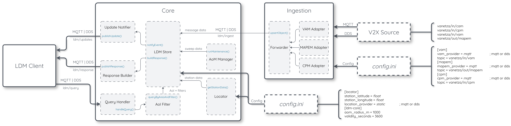

# Local Dynamic Map

## Architecture

[drawio](https://drive.google.com/file/d/1npu8NSyhw1E7h3KSJc8ghUrJZ_tloSjh/view?usp=sharing)

A Local Dynamic Map (LDM) stack for CPS V2 clustering deployments. The service set follows ETSI EN 302 895 / TR 102 863 semantics and reuses CPS-style middleware/config patterns.

## Repository layout

- `core/` - authoritative in-memory LDM core, unified MAPEM/VAM/CPM store, locator, query handling, metrics.
- `ingestion/` - MAPEM/VAM adapter-forwarder (`static | mqtt | dds`) into core ingest topic.
- `query/` - sample query frontend for publishing `ldm/query` and consuming `ldm/response`.
- `common/` - shared transport layer (Fast DDS, MQTT, Zenoh) and utilities.
- `agent/` - deployment templates.
- `metrics/` - Prometheus examples.

`ldm-core` is the only owner of persistent state and update events.

## Topic contract

- `ldm/ingest`
  - producer: `ldm-ingestion`
  - consumer: `ldm-core`
  - payload: raw MAPEM/VAM payloads forwarded from providers (not final change events)
- `ldm/response`
  - producer: `ldm-core`
  - consumer: external clients / `ldm-query`
- `ldm/updates`
  - producer: `ldm-core` only
  - consumer: external clients
  - payload: normalized state-change events (event-only semantics)

### `ldm/updates` normalized payload

```json
{
  "domain": "mapem",
  "event": "state_changed",
  "timestamp": 1710000000.123,
  "stats": {
    "station_count": 0,
    "object_count": 12,
    "sensor_count": 0,
    "perception_region_count": 0
  }
}
```

`domain` values: `mapem`, `vam`, `cpm`.

## Unified core store

`core/ldm_store` is a single physical store that contains all runtime domains:

- MAPEM/VAM objects with AoM upsert filtering and validity/maintenance expiration.
- CPM station-scoped state with scope, cadence, SIC, perception regions, object ids, and sweeper-based TTL handling.

There is no separate runtime `CpmStateStore` module.

## AOI vs AoM

- AoM: core-owned boundary (configured in `ldm-core.aom_radius_m` + locator station reference), enforced on ingest/maintenance.
- AOI: query-time region from client request payload (`ldm/query`) used to filter response results.

## Configuration

Each service reads `/config.ini`.

- `core/config.ini`
  - `[locator]`: station reference source (`static | mqtt | dds`)
  - `[ldm-core]`: AoM radius, validity/TTL values, topic names
- `ingestion/config.ini`
  - `[mapem]`, `[vam]`: provider, input topics, simulation options, `output_topics`
- `query/config.ini`
  - query defaults (`request_topic`, `response_topic`, AOI center, query type)

Default topic split:

- ingestion MAPEM/VAM output: `ldm/ingest`
- core updates output: `ldm/updates`

## Locator behavior

The locator runs inside core and mirrors CPS behavior:

- `location_provider = static | mqtt | dds`
- supports VANETZA CAM/CAM_FULL/VAM-style feeds for dynamic station reference
- `locator_update_interval_ms` controls refresh cadence for dynamic providers

## Query/response protocol

Query and response wire formats remain backward compatible.

Supported query types:

- `mapem`
- `vam`
- `cpm_state`
- `cpm_objects`
- `cpm_perception_regions`

Legacy aliases retained in parser routing:

- `cpm` -> `cpm_state`
- `cpm_sensors` -> `cpm_state`
- `cpm_regions` -> `cpm_perception_regions`

CPM filters:

- `include_own`, `include_external`
- `max_object_age_ms`, `max_sic_age_s`, `max_perception_region_age_s`
- `station_ids`, `limit_objects`, `limit_sensors`, `limit_regions`

## Ingestion simulation

MAPEM and VAM can be simulated from file in `ldm-ingestion`:

```ini
[mapem]
mapem_provider = static
simulation_interval_ms = 2000
file_path = /maps/it2.json
```

```ini
[vam]
vam_provider = static
simulation_interval_ms = 1000
file_path = /maps/vam_sample.json
```
